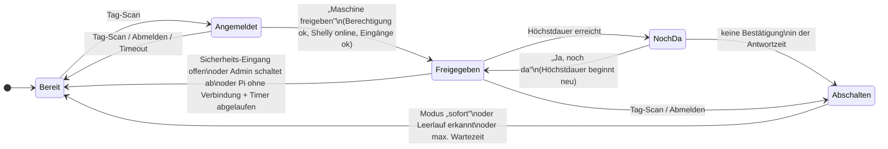

# Plan: Shelly-Steuerung

**Stand:** 2026-10-24 · **Status:** Phasen 1–3 umgesetzt, Phasen 4–7 offen

Ziel: Jede Maschine (Ausstattung) bekommt einen eigenen Raspberry Pi mit NFC-Leser und Touchscreen.
Ein Mitglied scannt seinen Tag am Pi. Hat es eine Berechtigung für diese Maschine, kann es sie per
Button freigeben, und ein Shelly schaltet den Strom ein. Beim Abmelden wird die Freigabe wieder
aufgehoben. Admins verwalten Shellys, Terminals und die Zuordnung zur Ausstattung.

Grundlage ist das Konzept in [`ShellyFlow.md`](../ShellyFlow.md). Dieser Plan weicht an einer
Stelle bewusst davon ab (siehe „Architektur").

## Entscheidungen

| Thema               | Entscheidung                                                                                                                                                 |
| ------------------- | ------------------------------------------------------------------------------------------------------------------------------------------------------------ |
| Geräte              | Möglichst alle Shellys: **Gen1 und Gen2+** (Plus, Pro, Gen3, Gen4)                                                                                           |
| Gerätefunktionen    | Relais, **Leistungsmessung**, **Eingänge**, **Dimmer/RGB**, **Rollladen/Cover**                                                                              |
| Nicht im Umfang     | Batterie-Sensoren (Tür, Temperatur, Wasser)                                                                                                                  |
| Terminals           | **Ein Pi pro Maschine**                                                                                                                                      |
| Einschalten         | Tag scannen → Button **„Maschine freigeben"** → Strom an                                                                                                     |
| Abmelden            | Freigabe wird aufgehoben. **Pro Maschine einstellbar:** sofort aus oder erst im Leerlauf                                                                     |
| Wer darf freigeben  | Wer laut bestehender Berechtigungsverwaltung (`member.equipmentPermissions`) für die Maschine freigeschaltet ist. **Admins dürfen jede Maschine freigeben.** |
| Höchstdauer         | **Pro Pi einstellbar:** Nach Ablauf fragt der Pi „Noch da?"; ohne Bestätigung wird abgeschaltet                                                              |
| Messwerte           | Live anzeigen und **eine Zusammenfassung je Nutzung** speichern (wer, wann, wie lange, kWh)                                                                  |
| Nutzungsdaten sehen | Nach den bestehenden Rechten, wie beim Audit-Log (siehe „Sichtbarkeit der Nutzungen")                                                                        |
| Pi ohne Verbindung  | Maschine läuft **bis zum Sicherheits-Timer** weiter und schaltet dann ab                                                                                     |
| Netzwerk            | Shellys im selben Netz wie der Server                                                                                                                        |

## Architektur: Das Backend schaltet, nicht der Pi

`ShellyFlow.md` sieht vor, dass die Pis sich mit einer verteilten Konfiguration direkt mit den
Shellys verbinden. Vorschlag stattdessen:

```
Pi (Kiosk-Frontend + nfc-bridge)  --Tag-Scan / „Freigeben"-->  Backend  --HTTP-->  Shelly
                                  <--WebSocket: Status--------  Backend  <--Polling / Webhooks--
```

- **Berechtigung wird an einer Stelle geprüft.** Sonst könnte jeder im Netz die Shelly-API direkt
  aufrufen.
- **Lückenloses Audit-Log und Nutzungsdaten** an einer Stelle.
- **Shelly-Zugangsdaten bleiben auf dem Server.**
- **Weniger Teile:** Die Konfiguration muss nicht erzeugt und an die Pis verteilt werden
  (S9, S10, P1–P3 im Konzept). Der Pi zeigt nur an und sendet Wünsche.

Die Zustände aus dem State-Diagramm (Discovered → Unassigned → Assigned → Active/Offline/Retired)
bleiben erhalten.

## Ablauf am Pi



1. **Bereit:** Der Pi zeigt Maschinenname und „Tag scannen".
2. **Angemeldet:** Der Pi zeigt das Mitglied und, ob es berechtigt ist. Der Button „Maschine
   freigeben" ist nur aktiv, wenn Berechtigung, Shelly-Verbindung und Sicherheits-Eingänge passen.
   Sonst steht dort der Grund.
3. **Freigegeben:** Strom an. Der Pi zeigt Laufzeit, aktuelle Leistung und Zusatzfunktionen
   (Dimmer, Rollladen, weitere Relais wie eine Absaugung).
4. **Abschalten** (Abmelden per Tag-Scan oder Button):
   - Modus **„sofort"**: Relais aus.
   - Modus **„im Leerlauf"**: Relais aus, sobald die Leistung eine Zeit lang unter einer Schwelle
     liegt (z. B. < 20 W für 60 s), spätestens nach der maximalen Wartezeit. Der Pi zeigt
     „Maschine wird nach Jobende abgeschaltet". Dieser Modus braucht Leistungsmessung.
   - Meldet sich währenddessen ein berechtigtes Mitglied an und gibt frei, läuft die Maschine
     ohne Unterbrechung weiter.
5. **„Noch da?"** (nur wenn am Pi eine Höchstdauer eingestellt ist, z. B. 4 h): Der Pi fragt nach,
   gut sichtbar und mit Ton, falls vorhanden. Bestätigt das Mitglied innerhalb der Antwortzeit
   (z. B. 5 Min.), beginnt die Höchstdauer neu. Sonst beginnt das Abschalten wie beim Abmelden
   (Grund `timeout`). Ohne eingestellte Höchstdauer gibt es keine Nachfrage.

**Admins** sehen am Pi den Button „Maschine freigeben" immer, auch ohne Eintrag in der
Berechtigungsverwaltung. Im Audit-Log steht dann `machine.release` mit dem Vermerk
`adminOverride`.

**Pi ohne Verbindung:** Der Pi meldet sich über den WebSocket regelmäßig beim Backend. Bleibt
das aus, erneuert das Backend den Sicherheits-Timer am Shelly nicht mehr. Die Maschine läuft
weiter, bis der Timer abläuft, und schaltet dann ab (Grund `terminal-offline`). Kommt der Pi
vorher zurück, läuft die Freigabe normal weiter.

## Sicherheit

### Terminals bekommen einen geheimen Schlüssel

Heute vertraut das Backend den Headern `X-User-ID`, `X-User-Role` und `X-Device-ID`, die der
Client selbst setzt. Für das **Einschalten von Maschinen** reicht das nicht: Mit einem `curl` und
gefälschten Headern ließe sich jede Maschine einschalten.

- Ein Admin legt im Frontend ein **Terminal** an (Name, Maschine). Das Backend erzeugt einen
  Schlüssel und zeigt ihn **einmal** an. Gespeichert wird nur ein Hash.
- Auf dem Pi steht der Schlüssel in der `.env` der `nfc-bridge` und in der Kiosk-Konfiguration des
  Frontends. Beide schicken ihn als `Authorization: Bearer <token>`.
- Das Backend bestimmt **aus dem Schlüssel**, welches Terminal und damit welche Maschine es ist,
  und **aus dem Tag-Scan an diesem Terminal**, welches Mitglied angemeldet ist. Header des Clients
  zählen dafür nicht.
- Schlüssel kann neu erzeugt werden, ein Terminal kann deaktiviert werden.

### Sicherheits-Timer auf dem Shelly („Totmannschalter")

Beim Freigeben setzt das Backend das Relais mit Auto-Aus-Timer (Gen2: `toggle_after`, Gen1:
`timer`), z. B. 3 Minuten, und erneuert ihn jede Minute, solange die Freigabe besteht **und der Pi
erreichbar ist**. Fällt das Backend, das Netz oder der Pi aus, schaltet der Shelly die Maschine
selbst ab. Die Dauer ist pro Maschine einstellbar, damit ein kurzer Ausfall keinen Job abbricht.

### Grenzen

- Ein Relais ist **keine Sicherheitsabschaltung**. Not-Aus bleibt Sache der Maschine.
- Der Pi darf **nicht** über den Shelly der Maschine mit Strom versorgt werden.

## Shelly-Unterstützung

Zwei Treiber hinter einer gemeinsamen Schnittstelle. Beim Hinzufügen erkennt das Backend die
Generation über `GET /shelly` (Gen2+ liefert `gen`, Gen1 nicht) und liest aus, welche Funktionen
das Gerät hat.

```ts
interface ShellyDriver {
  probe(host: string): Promise<ShellyProbeResult>; // Modell, MAC, Firmware, Komponenten
  getStatus(host: string): Promise<ShellyDeviceStatus>;
  setSwitch(host: string, index: number, on: boolean, autoOffSec?: number): Promise<void>;
  setLight(host: string, index: number, on: boolean, brightness?: number): Promise<void>;
  setCover(
    host: string,
    index: number,
    action: 'open' | 'close' | 'stop',
    pos?: number
  ): Promise<void>;
}
```

| Funktion   | Gen2+ (JSON-RPC)                                                                                           | Gen1 (REST)                                   |
| ---------- | ---------------------------------------------------------------------------------------------------------- | --------------------------------------------- |
| Erkennen   | `GET /shelly`, `Shelly.GetStatus` (Schlüssel `switch:0`, `input:0`, `light:0`, `cover:0`, `pm1:0`, `em:0`) | `GET /shelly`, `GET /settings`, `GET /status` |
| Relais     | `Switch.Set?id=0&on=true&toggle_after=180`                                                                 | `/relay/0?turn=on&timer=180`                  |
| Messung    | `apower`, `voltage`, `current`, `aenergy.total` (Wh)                                                       | `meters[]` / `emeters[]` (`power`, `total`)   |
| Eingänge   | `input:N.state`                                                                                            | `inputs[].input`                              |
| Dimmer/RGB | `Light.Set?id=0&on=true&brightness=50`                                                                     | `/light/0?turn=on&brightness=50`              |
| Rollladen  | `Cover.Open/Close/Stop`, `Cover.GoToPosition`                                                              | `/roller/0?go=open\|close\|stop\|to_pos`      |
| Anmeldung  | HTTP Digest (SHA-256, Benutzer `admin`)                                                                    | HTTP Basic                                    |

Die genauen Feldnamen werden beim Bau der Treiber gegen die offizielle Shelly-API-Doku und echte
Geräte geprüft.

## Datenmodell

Neue Typen in `packages/shared-types/src/index.ts`. Shellys und Terminals liegen als neue
Dokumenttypen in `mks_members`, die Nutzungen in einer neuen Datenbank `mks_usage`
(`COUCHDB_USAGE_DB_NAME`).

```ts
export type ShellyGen = 1 | 2; // 2 = Gen2+ (inkl. Gen3/Gen4, gleiche API)
export type ShellyComponentKind = 'switch' | 'input' | 'light' | 'cover' | 'meter';
export type ShellyHealth = 'online' | 'degraded' | 'offline' | 'unknown';

export interface ShellyComponent {
  kind: ShellyComponentKind;
  index: number;
  hasPowerMeter?: boolean; // z. B. Plus 1PM: Messung direkt am Relais
}

export interface ShellyDevice {
  type?: 'shellyDevice';
  id: string;
  shellyId: string; // z. B. "shellyplus1pm-a8032ab12345"
  mac: string;
  model: string;
  gen: ShellyGen;
  host: string; // feste IP oder Hostname
  name: string;
  firmware?: string;
  components: ShellyComponent[];
  health: ShellyHealth;
  lastSeenAt?: string;
  isActive: boolean; // false = ausgemustert
}

export interface ComponentRef {
  deviceId: string;
  kind: ShellyComponentKind;
  index: number;
}

export interface EquipmentControl {
  power: ComponentRef; // Hauptschalter (Relais)
  meter?: ComponentRef; // nur nötig, wenn die Messung nicht am Hauptschalter sitzt
  interlocks?: ComponentRef[]; // Eingänge, die geschlossen sein müssen
  extras?: { label: string; ref: ComponentRef }[]; // Dimmer, Rollladen, weitere Relais
  shutdown: {
    mode: 'immediate' | 'when-idle';
    idleThresholdW?: number; // z. B. 20
    idleSeconds?: number; // z. B. 60
    maxWaitMinutes?: number; // z. B. 30
  };
  watchdogMinutes: number; // Sicherheits-Timer, Standard 3
}

// Erweiterung der bestehenden Equipment-Schnittstelle:
//   control?: EquipmentControl;

export interface Terminal {
  type?: 'terminal';
  id: string; // = DEVICE_ID des Pi
  name: string;
  equipmentId: string;
  tokenHash: string;
  maxSessionMinutes?: number; // Höchstdauer einer Freigabe an diesem Pi, leer = keine
  stillThereTimeoutMinutes?: number; // Antwortzeit für „Noch da?", Standard 5
  lastSeenAt?: string;
  isActive: boolean;
}

export interface EquipmentUsage {
  type?: 'equipmentUsage';
  id: string;
  equipmentId: string;
  memberId: string;
  terminalId: string;
  startedAt: string;
  endedAt?: string; // fehlt = Freigabe läuft noch
  durationSec?: number;
  energyWh?: number; // Zählerstand Ende minus Start
  adminOverride?: boolean; // Admin ohne Eintrag in der Berechtigungsverwaltung
  endReason?:
    | 'logout'
    | 'timeout'
    | 'interlock'
    | 'admin'
    | 'device-offline'
    | 'terminal-offline'
    | 'watchdog';
}
```

Ob ein Shelly „zugeordnet" ist, ergibt sich aus den `control`-Einträgen der Ausstattung. Laufende
Freigaben sind offene `EquipmentUsage`-Dokumente. So übersteht eine Freigabe auch einen
Backend-Neustart: Das Backend liest beim Start die offenen Nutzungen und erneuert die Timer weiter.
Das Shelly-Passwort steht zunächst als **eine** Umgebungsvariable `SHELLY_PASSWORD` für alle
Geräte, nicht in CouchDB.

## Backend

Neue Dateien:

- `src/shelly/drivers/gen1.ts`, `src/shelly/drivers/gen2.ts`, `src/shelly/driver.ts` (Auswahl)
- `src/shelly/healthMonitor.ts`: Abfrage alle 5 s bei laufender Freigabe, sonst alle 30 s.
  Offline nach 3 Fehlversuchen. Änderungen per WebSocket.
- `src/shelly/machineControl.ts`: Freigeben, Abschalten (sofort / Leerlauf), Totmannschalter,
  Eingänge überwachen, Nutzung schreiben
- `src/terminals/terminalAuth.ts`: Middleware, prüft den Bearer-Schlüssel
- `src/routes/shellyRoutes.ts`, `src/routes/terminalRoutes.ts`, `src/routes/usageRoutes.ts`
- Anpassung `authRoutes.ts`: Ein Tag-Scan mit Terminal-Schlüssel meldet am Terminal an oder ab

Endpunkte:

| Methode             | Pfad                                   | Wer                                            | Zweck                                       |
| ------------------- | -------------------------------------- | ---------------------------------------------- | ------------------------------------------- |
| GET                 | `/api/shelly/devices`                  | admin                                          | Liste mit Status und Messwerten             |
| POST                | `/api/shelly/devices` `{ host }`       | admin                                          | Gerät prüfen und anlegen                    |
| PUT                 | `/api/shelly/devices/:id`              | admin                                          | Name, Host                                  |
| POST                | `/api/shelly/devices/:id/identify`     | admin                                          | kurz schalten zum Wiederfinden              |
| DELETE              | `/api/shelly/devices/:id`              | admin                                          | ausmustern                                  |
| GET/POST/PUT/DELETE | `/api/terminals`                       | admin                                          | Terminals verwalten, POST liefert Schlüssel |
| POST                | `/api/terminals/:id/rotate-token`      | admin                                          | neuen Schlüssel erzeugen                    |
| PUT                 | `/api/equipment/:id/control`           | admin                                          | Steuerung der Maschine konfigurieren        |
| POST                | `/api/equipment/:id/force-off`         | admin                                          | Freigabe aus der Ferne beenden              |
| GET                 | `/api/terminal/state`                  | Terminal                                       | Maschine, Mitglied, Freigabe, Messwerte     |
| POST                | `/api/terminal/release`                | Terminal                                       | „Maschine freigeben"                        |
| POST                | `/api/terminal/logout`                 | Terminal                                       | Abmelden (startet Abschalten)               |
| POST                | `/api/terminal/extras/:n` `{ action }` | Terminal                                       | Dimmer, Rollladen, Zusatzrelais             |
| POST                | `/api/terminal/still-there`            | Terminal                                       | „Ja, noch da" bestätigen                    |
| GET                 | `/api/usage?equipmentId=&memberId=`    | angemeldet, gefiltert nach Rolle (siehe unten) | Nutzungen                                   |

### Sichtbarkeit der Nutzungen

Nach den bestehenden Rechten, so wie beim Audit-Log (`auditRoutes.ts`):

| Rolle           | Sieht                                                                                    |
| --------------- | ---------------------------------------------------------------------------------------- |
| admin, vorstand | alle Nutzungen                                                                           |
| bereichsleitung | Nutzungen der Ausstattung in den eigenen Bereichen (`area.bereichsleiterIds`) und eigene |
| mitglied        | nur die eigenen Nutzungen                                                                |

Aufbewahrung: Löschung wie beim Audit-Log über eine eigene Variable `USAGE_RETENTION_DAYS`
(Standard 365, wie `AUDIT_RETENTION_DAYS`). Die Rolle wird dafür wie heute aus den Headern
gelesen. Sobald es eine sichere Anmeldung auch außerhalb der Terminals gibt, sollte diese Prüfung
darauf umziehen.

WebSocket: neue Ereignistypen `machine-state` (pro Terminal) und `shelly-health` über
`/ws/auth`. Das Frontend ignoriert unbekannte Typen schon heute (Type Guards in
`authEventSource.ts`).

Audit-Aktionen: `shelly.device.create`, `shelly.device.retire`, `terminal.create`,
`terminal.rotate-token`, `equipment.control.update`, `machine.release`, `machine.release.denied`,
`machine.off` (mit Grund), `machine.force-off`.

## Frontend

- **Kiosk-Seite `/terminal`** für den Pi: großes Layout für Touch, alle Bedienelemente mindestens
  44×44 px. Zustände wie im Ablauf oben. Die Terminal-Konfiguration (ID, Schlüssel) wird einmalig
  über eine Einrichtungsseite gesetzt und im `localStorage` gespeichert.
- **Neue Admin-Seite `/devices` „Geräte"**: Shellys mit Modell, IP, Generation, Status und
  Live-Messwerten. Dialog „Gerät hinzufügen" (IP → Prüfung → Anlegen), „Identifizieren",
  „Ausmustern".
- **Neue Admin-Seite `/terminals`**: Terminals anlegen, Schlüssel anzeigen bzw. neu erzeugen,
  Höchstdauer und Antwortzeit für „Noch da?", letzter Kontakt.
- **`EditEquipmentPage`**: neuer Abschnitt „Steuerung": Hauptschalter, Messung, Eingänge,
  Zusatzfunktionen, Abschaltmodus mit Schwellwerten, Timer. Dazu laufende Freigabe und Button
  „Abschalten" für Admins.
- **Nutzungen**: Liste pro Maschine und pro Mitglied (Zeitraum, Dauer, kWh).

## Netzwerk und Betrieb

- Shellys im selben Netz wie der Server: Das Backend erreicht sie direkt per HTTP.
- Den Shellys **feste IPs** per DHCP-Reservierung geben.
- Automatische Erkennung (mDNS) ist im selben Netz möglich, funktioniert aber nicht aus dem
  Docker-Bridge-Netz des Backends. Darum zuerst IP manuell eintragen. Später ein kleiner Dienst mit
  `network_mode: host` (wie die `nfc-bridge`), der gefundene Geräte meldet.
- Pi-Image: Chromium im Kiosk-Modus auf `/terminal` und die `nfc-bridge` mit `DEVICE_ID` und
  `TERMINAL_TOKEN`. Anleitung dazu kommt nach `docs/`.
- Neue Variablen: `SHELLY_PASSWORD`, `SHELLY_POLL_INTERVAL_MS`, `COUCHDB_USAGE_DB_NAME`,
  `USAGE_RETENTION_DAYS`.

## Testen ohne Hardware

In der Cloud und in der CI gibt es keine Shellys und keine Pis.

- `tests/helpers/mockShelly.ts`: HTTP-Server, der **ein Gen1- und ein Gen2-Gerät** nachbildet
  (Relais, Messung mit einstellbarer Leistung, Eingänge, Dimmer, Rollladen, Timer, „offline").
- Das Terminal wird im Test über einen angelegten Schlüssel und `POST /api/auth/tag` simuliert.
- Neue E2E-Specs: `devices.spec.ts`, `terminals.spec.ts`, `machine-control.spec.ts` (freigeben,
  ohne Berechtigung abgelehnt, Admin ohne Berechtigung erlaubt, sofort aus, Leerlauf-Abschaltung,
  „Noch da?" bestätigt und unbeantwortet, Eingang offen, Shelly offline, Pi ohne Verbindung,
  Totmannschalter, Neustart mit laufender Freigabe), `usage.spec.ts` (Sichtbarkeit je Rolle).

## Umsetzung in Phasen

Jede Phase ist ein eigener PR und für sich lauffähig.

1. ✅ **Treiber und Geräteverwaltung:** Typen, Gen1- und Gen2-Treiber, Erkennung der Funktionen,
   Mock-Shelly, Seite „Geräte", Identifizieren.
2. ✅ **Terminals und sichere Anmeldung:** Terminal-Dokumente, Schlüssel, Anmeldung per Tag-Scan am
   Terminal, `nfc-bridge` und Kiosk schicken den Schlüssel.
3. ✅ **Maschine freigeben:** `control`-Konfiguration, Kiosk-Seite, Freigeben (inkl. Admin),
   Abmelden mit „sofort aus", Totmannschalter, Pi ohne Verbindung, „Noch da?", Nutzungen ohne kWh,
   Audit.
4. **Messung und Leerlauf-Abschaltung:** Live-Messwerte, Modus „im Leerlauf", kWh in Nutzungen,
   Nutzungsansicht mit Sichtbarkeit je Rolle, Aufbewahrungsfrist.
5. **Eingänge und Zusatzfunktionen:** Sicherheits-Eingänge, Dimmer, Rollladen, Zusatzrelais.
6. **Überwachung und schnellere Reaktion:** Health-Monitor im Frontend, Admin-Abschaltung,
   Push vom Shelly statt Polling (Gen2: Webhooks/Outbound-WebSocket, Gen1: Action-URLs), damit
   Eingänge sofort reagieren.
7. **Später/optional:** mDNS-Erkennung, Firmware-Updates, Wartungsmodus, Einrichtungsanleitung
   für das Pi-Image.

### Stand Phase 1

Umgesetzt: gemeinsame Typen, Gen1- und Gen2+-Treiber (Basic- bzw. Digest-Anmeldung), Erkennung von
Relais, Messung, Eingängen, Dimmer, Rollladen und Messgeräten, API `/api/shelly/devices` (nur
admin), Seite „Shelly-Geräte" (`/devices`) mit Live-Status, Identifizieren, Bearbeiten,
Ausmustern, Test-Shelly `tests/helpers/mockShelly.ts` und `tests/e2e/devices.spec.ts`.

Abweichungen vom Plan oben:

- `gen` wird als Zahl gespeichert (1, 2, 3, 4). Alles ab 2 nutzt den Gen2-Treiber.
- `health` kennt vorerst nur `online`, `offline` und `unknown`. `degraded` kommt mit dem
  Health-Monitor (Phase 6).
- Der Status wird beim Öffnen der Seite und dann alle 10 s abgefragt, noch nicht im Backend.
- Adressen: nur IPv4 im lokalen Netz (10/8, 172.16/12, 192.168/16, 127/8, 169.254/16), damit
  das Backend nicht beliebige Server abfragen kann.

### Stand Phase 2

Umgesetzt: Terminals (`/api/terminals`, Seite „Terminals" für Admins) mit Schlüssel, der nur
einmal angezeigt wird (gespeichert wird nur der SHA-256-Hash). Höchstens ein Terminal pro
Maschine. Der Pi meldet sich mit `Authorization: Bearer mkt_…` an (`/api/terminal/state`,
`/logout`, `/activity`). Die `nfc-bridge` schickt den Schlüssel mit, wenn `TERMINAL_TOKEN` gesetzt
ist. Kiosk-Seite `/terminal`: Einrichtung per Schlüssel, Anzeige von Maschine, Mitglied und
Berechtigung (inkl. Admin-Freigabe und „Maschine nicht verfügbar"), Abmelden per Tag oder Button.
Tests: `tests/e2e/terminals.spec.ts`.

Wichtige Entscheidungen dabei:

- **Scans an einem Terminal wirken nur dort.** Vorher ging jeder Tag-Scan per WebSocket an alle
  Browser und meldete überall an. Scans mit Terminal-Schlüssel werden jetzt nicht mehr als
  `TagEvent` verteilt; es geht nur ein `terminal-state`-Hinweis ohne Mitgliedsdaten raus, und der
  Pi holt sich die Details mit seinem Schlüssel. Ein Pi im Kiosk-Modus ignoriert umgekehrt Scans
  vom Eingangs-Leser und zeigt keine anderen Seiten.
- **Anmeldungen am Pi liegen im Speicher des Backends.** Ein Neustart meldet alle Pis ab.
  Freigaben ab Phase 3 werden dagegen gespeichert.
- **Automatische Abmeldung** ohne Freigabe nach 5 Minuten ohne Bedienung
  (`TERMINAL_IDLE_TIMEOUT_MS`). Jede Berührung am Pi verlängert. Ab Phase 3 gilt das nur, solange
  die Maschine nicht freigegeben ist.
- Die Berechtigung wird bei jeder Statusabfrage neu geprüft, nicht nur beim Anmelden. Wird sie
  entzogen, sieht der Pi das sofort.

### Stand Phase 3

Umgesetzt: Steuerung pro Maschine (`PUT/DELETE /api/equipment/:id/control`, Abschnitt
„Steuerung" auf der Ausstattungsseite): Shelly-Gerät, Ausgang (Relais oder Licht),
Sicherheits-Timer. Am Pi: Button „Maschine freigeben" (`POST /api/terminal/release`), Anzeige
„freigegeben" mit Laufzeit, Abmelden schaltet sofort aus, Rückfrage „Noch da?"
(`POST /api/terminal/still-there`). Jede Freigabe wird als `EquipmentUsage` in der neuen Datenbank
`mks_usage` gespeichert (`COUCHDB_USAGE_DB_NAME`), mit Grund fürs Ende. Code:
`apps/backend/src/machines/`. Tests: `tests/e2e/machine-control.spec.ts`.

Verhalten im Detail:

- **Sicherheits-Timer:** Einschalten mit `toggle_after` (Gen2) bzw. `timer` (Gen1). Das Backend
  erneuert ihn alle Timer/3, solange der Pi sich meldet. Schlägt das Erneuern bis zum Ablauf fehl,
  endet die Freigabe mit `device-offline`; der Shelly hat dann selbst abgeschaltet.
- **Pi ohne Verbindung:** Der Pi meldet sich über seine Statusabfragen (Takt kommt vom Backend,
  `pollIntervalMs`). Nach `TERMINAL_OFFLINE_AFTER_MS` (Standard 60 s) ohne Meldung wird nicht mehr
  erneuert; die Maschine läuft bis zum Ablauf des Timers und die Freigabe endet mit
  `terminal-offline`. Kommt der Pi vorher zurück, läuft alles weiter.
- **Während einer Freigabe** gilt die automatische Abmeldung nach Leerlauf nicht; stattdessen
  „Noch da?" nach der Höchstdauer des Pi. Ohne Antwort: abmelden und ausschalten (`timeout`).
- **Neustart des Backends:** Offene Freigaben werden aus `mks_usage` wieder aufgenommen, inklusive
  Anmeldung am Pi; der Timer wird sofort erneuert. Passt die Konfiguration nicht mehr, wird die
  Freigabe mit `system` geschlossen.
- **Schutz:** Ein zugeordneter Shelly kann nicht ausgemustert werden, ein Ausgang schaltet nur eine
  Maschine, und „Identifizieren" ist gesperrt, solange die Maschine freigegeben ist.
- Zeiten in Minuten (Timer, Höchstdauer, Antwortzeit) werden mit `TERMINAL_MINUTE_MS` gerechnet
  (Standard 60 000). Die Tests setzen 1000, damit eine „Minute" eine Sekunde dauert.

Noch nicht in Phase 3: Wird die Berechtigung entzogen oder die Maschine während einer Freigabe als
nicht verfügbar markiert, läuft die Freigabe weiter bis zum Abmelden. Fernabschaltung durch Admins
kommt mit Phase 6.

## Risiken

- **Abschalten unter Last:** Deshalb pro Maschine „sofort" oder „im Leerlauf", und ein
  einstellbarer Totmannschalter.
- **Reaktionszeit der Eingänge:** Bis Phase 6 werden Eingänge abgefragt (alle 5 s während einer
  Freigabe). Für zeitkritische Fälle reicht das nicht. Not-Aus bleibt ohnehin Sache der Maschine.
- **„Identifizieren" schaltet das Relais:** Nur für Geräte ohne Zuordnung oder nach ausdrücklicher
  Bestätigung.
- **Gen1-Vielfalt:** Gen1-Modelle unterscheiden sich stärker. Unterstützt werden zuerst Relais,
  Messung, Eingänge, Dimmer und Rollladen; exotische Modelle nach Bedarf.
- **Datenschutz:** Nutzungen sind personenbezogen. Darum Sichtbarkeit nach Rolle und
  automatische Löschung nach `USAGE_RETENTION_DAYS`.
- **Rollen-Header beim Lesen der Nutzungen:** Wie überall außerhalb der Terminals kommt die Rolle
  aus Headern, die der Client setzt. Für das Schalten ist das durch die Terminal-Schlüssel gelöst,
  für das Lesen von Nutzungen noch nicht.

## Offene Fragen

Keine. Alle Fragen sind in „Entscheidungen" beantwortet.
